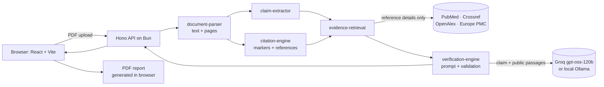

# CiteVerify AI — Hackathon Submission Guide

Live site: https://citeverify-ai.onrender.com · Code: https://github.com/kiran-ys/CiteVerify-AI-1 (branch `feature/rag-verification`)

## 1. Problem

Scientific papers cite other papers to back their claims, but reviewers rarely have time to check whether each cited source actually says what the paper claims. Mis-citations, overstated findings, and wrong numbers slip through.

## 2. Solution

CiteVerify AI takes a research PDF, finds the claims that cite other work, looks up the cited papers in free scholarly databases, and shows each claim next to the exact source passages. An AI model then judges, part by part, whether those passages support the claim, and the app derives the verdict in code. When the evidence cannot settle a claim, it says **Unable to verify** and explains why. It never invents evidence.

## 3. Key features (all implemented)

- PDF upload (25 MB limit) with page-level text extraction, including superscript citations read from the layout.
- Rule-based claim extraction, separating claims that cite other work from the paper's own findings.
- Citation matching to the paper's reference list (numeric, bracketed, superscript, author-year).
- Internal-consistency checks of the paper's own numbers, confidence intervals, and p-values.
- Source retrieval via PubMed, Crossref, OpenAlex, and Europe PMC with strict identity checks; abstract versus full-text evidence is labelled.
- Evidence-grounded AI verification (Groq `openai/gpt-oss-120b` online, Ollama `llama3.2` locally) with verdicts derived in code from cited passages.
- Results kept across page switches and reloads in the browser tab; downloadable PDF report with limitations and disclaimer.
- A 48-case benchmark with fixed evidence and a reproducible metrics runner.

## 4. Architecture

## 5. Technology

Bun, TypeScript, Turborepo, React, Vite, Tailwind CSS, Hono, unpdf (pdf.js), Biome, Docker, Render (free tier), Groq API (free tier), Ollama.

## 6. How verification works

1. Each cited claim keeps its exact text and page.
2. Its citation markers are matched to reference entries; each reference is identified by its printed PubMed ID or by DOI/bibliographic search, and rejected unless title, year, and first author agree.
3. Abstracts (and open-access full text) are fetched; up to 4 passages per source and 10 per claim are selected by term overlap.
4. The model receives only the claim and those passages, splits the claim into its stated parts, and marks each part supported, contradicted, or not reported, citing passage ids (prompt `verify-v5`).
5. Code validates the answer (every cited id must exist; uncited support is discarded; one retry for malformed answers) and derives the verdict. Displayed evidence is always stored source text, never model-written text.

**Verdicts.** *Supported*: every stated part is backed by a passage. *Partially supported*: some parts are. *Contradicted*: a passage states something incompatible with the claim and no part is supported. *Unable to verify*: the retrieved evidence cannot settle the claim (missing, inaccessible, off-topic, or incomplete), or the model failed; the reason is always shown. *Unsupported* is not issued: in a live test the hosted model labelled on-topic but incomplete sources as "different question" far too often, so the app reports those as Unable to verify with a note. Unable to verify never means a claim is false.

## 7. What is genuinely implemented and tested

See `docs/PROJECT_STATUS.md` for the full record. 263 automated tests pass (lint, typecheck with cache bypassed, build). The live site was tested end to end with the open-access Ioannidis (2005) paper: 21 cited claims verified by Groq in about 160 s with no model failures.

## 8. Benchmark (agreement with provisional labels — not validated accuracy)

`eval/benchmark/cases.json`: 48 cases with fixed evidence passages; 38 real claims from two open-access papers and 10 deliberately altered ones (5 changed numbers/direction/population, 5 claims paired with an unrelated source). **All labels are provisional and AI-assisted; none has been independently reviewed.** Reports are in `docs/evaluation/`.

Measured so far (local `llama3.2`, the small fallback model; the hosted Groq model has **not** been benchmarked yet):

| Run | Agreement | Macro F1 | Weighted F1 | Abstention | Invalid output | Cited evidence is stored source text |
| --- | --- | --- | --- | --- | --- | --- |
| `verify-v4` | 16/48 (33%) | 0.29 | — | 12.5% | 2.2% | 100% (35/35) |
| `verify-v7` (experimental, not deployed) | 14/48 (29%) | 0.28 | 0.30 | 10.4% | 4.3% | 100% (43/43) |

The local model rarely answers Supported and, under `verify-v6`/`v7`, often marks an unaddressed finding as "contradicted" (16 false Contradicted). These are weaknesses of the 3B local model; the hosted model's behaviour must be measured before conclusions are drawn. Live, the Groq model produced no Contradicted verdicts on Ioannidis 2005 and agreed with 10 of 21 provisional labels (`verify-v5`), with every disagreement on the cautious side. Reports: `docs/evaluation/`.

## 9. Reliability testing

Automated tests cover: password-protected, truncated, and oversized PDFs; PDFs with no text, no claims, or no reference list; every scholarly service down; rate limits with Retry-After; Crossref pacing; missing, rejected, and rate-limited Groq keys; model timeouts; empty, malformed, or hallucinated-evidence answers (retried once, then Unable to verify). None of these produces a verdict.

## 10. Limitations

- Accuracy is unmeasured against independently reviewed labels; the benchmark labels are provisional.
- Most evidence is from abstracts; full text is available only for open-access papers.
- The model is cautious: many claims end as Unable to verify where a human might credit partial support.
- Free-tier limits (Render shared IPs, Crossref 1 request/second, OpenAlex daily budget, Groq quotas) can slow or reduce retrieval; failures are reported, not hidden.
- A full paper takes 2-3 minutes in one request; claim extraction is rule-based and can miss or split claims.

## 11. Future work

Human review of the benchmark labels; background jobs instead of one long request; larger benchmark across fields; user accounts and rate limiting; DOI, metadata, and retraction checks.

## 12. Three-minute demo script

1. **(0:00)** Open https://citeverify-ai.onrender.com. "The dashboard shows demo data, clearly labelled. Real work starts at Upload Paper."
2. **(0:20)** Upload the open-access Ioannidis 2005 PDF (*Why Most Published Research Findings Are False*, PLoS Medicine). Click **Extract text, claims and citations**. Show page count, extracted text, and claims with their matched citations.
3. **(0:50)** Click **Verify claims with AI**. While the timer runs: "Each reference is identified in PubMed and Crossref, abstracts are fetched, and Groq judges each claim only against those passages."
4. **(1:50)** Open claim-011 (CONSORT/QUOROM): **Supported**, with the exact source sentences and DOI links. Open a claim marked **Unable to verify**: "Here the abstract does not settle the claim, so we abstain and say why, instead of guessing."
5. **(2:20)** Switch to Dashboard and back: results persist. Go to Reports, **Download PDF report**, and show the limitations section.
6. **(2:45)** "Every verdict is traceable to stored source text; our 48-case benchmark and its limits are in the repository."
